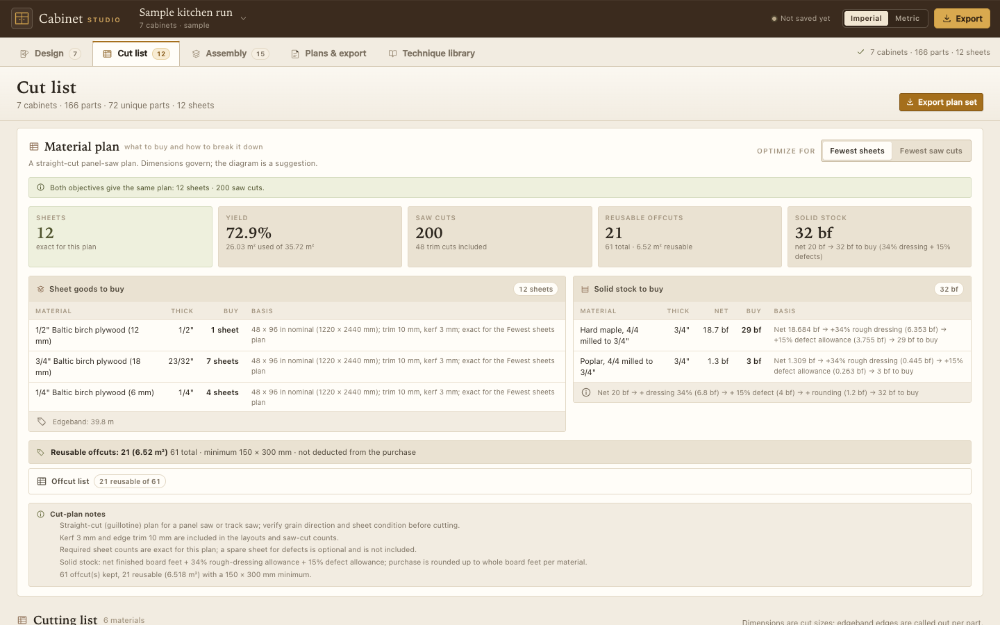

# Cabinet Studio

**A local-first cabinet design and shop-drawing app for small shops.**

Design a kitchen run, choose the construction method and sheet-goods thickness, get a cut list and
guillotine cutting plan, and export a full PDF plan set plus DXF/DWG — offline, with no account,
server or build step.

## Run it

1. Download/clone the repository.
2. Open **`index.html`** in Chrome, Safari or Firefox.
3. The sample kitchen opens on the run overview. Use **New project** in the project menu to start
   from an empty wall.

There is no server, no npm install and no network request at runtime. If a browser blocks a
`file://` download, serve the folder locally with `python3 -m http.server 8000` and open
`http://localhost:8000`.

## What it does

- **Guided design:** nine one-question steps — Space → Standard → Box → Size → Build → Layout →
  Front style → Inside & finish → Review. Live drawing and remaining-run guidance at every step.
- **Build choices:** six researched carcass methods (confirmat, pocket screw, dado/rabbet, dowel,
  biscuit alignment, butt screw); 18 mm structural sheet goods or 12 mm light-duty panels; back,
  toe-kick and face-frame joint options. Changing the panel updates parts, warnings, assembly and
  plans.
- **Standard presets:** North American face frame and European frameless 32 mm defaults.
- **Run overview and full editor:** the Advanced editor exposes every remaining field; guided edits
  preserve advanced values.
- **Material plan:** sheet purchase quantities, a straight-cut/guillotine cut sequence per sheet,
  saw-cut counts, reusable offcuts, and solid-wood board footage with rough-dressing/defect
  allowances. Optimize for fewest sheets or fewest saw cuts.
- **Exports:** vector PDF shop plan set (elevations, sections, components with machining, cut list,
  material plan, nesting/cut sequences, schedules, assembly order), DXF R2000/R12, and real DWG
  R2000/R2018/R12.
- **Offline/local-first:** projects autosave in the browser; save/open JSON files; no telemetry.

## Limits

- The cut plan is a **panel-saw/table-saw straight-cut plan**, not a CNC nesting/toolpath promise.
  Verify grain, sheet tolerance, blade kerf and defects before cutting.
- This is a design and shop-drawing aid, not structural, engineering, electrical or code advice.
  Verify site conditions, hardware ratings and local requirements.
- Tested primarily in Chromium; the app uses standard browser APIs and has also been opened in
  Safari manually. See `docs/` for the longer design and testing notes.

## Documentation

- [`docs/UX-REDESIGN.md`](docs/UX-REDESIGN.md) — guided flow and run overview
- [`docs/BUILD-METHODS.md`](docs/BUILD-METHODS.md) — build/thickness research matrix
- [`docs/CUT-PLANNING-SPEC.md`](docs/CUT-PLANNING-SPEC.md) — material planner and cut-plan contract
- [`docs/RESEARCH-techniques.md`](docs/RESEARCH-techniques.md) — construction research and sources
- [`docs/RESEARCH-UI-FLOW.md`](docs/RESEARCH-UI-FLOW.md) — guided-UI research
- [`docs/RESEARCH-CUT-PLANNING.md`](docs/RESEARCH-CUT-PLANNING.md) — cut-planning research

Sample outputs are in [`samples/`](samples/): a 95-page plan set PDF and a real R2000 DWG/DXF.

## Licence

**GPL-3.0-only.** Copyright © 2026 VengefulOtter.

This program is free software: you can redistribute it and/or modify it under the terms of the
GNU General Public License as published by the Free Software Foundation, version 3 only. It is
distributed in the hope that it will be useful, but **WITHOUT ANY WARRANTY**; without even the
implied warranty of merchantability or fitness for a particular purpose. See [`LICENSE`](LICENSE)
for the full terms. The complete corresponding source is this repository; if you distribute a
modified version, keep it under GPL-3.0-only and make the source available.

Third-party components and notices: [`THIRD_PARTY_NOTICES.md`](THIRD_PARTY_NOTICES.md). Security model and reporting: [`SECURITY.md`](SECURITY.md). jsPDF and
nasjidwg are MIT-licensed; the jsPDF MD5 helper was replaced with a clean-room implementation.

## Provenance

Developed with AI coding and research assistance. The maintainer selected and reviewed the design,
calculations, code and documentation, and commissioned independent testing. AI systems can reproduce
patterns from training data; no third-party source code is knowingly included except the libraries
listed in `THIRD_PARTY_NOTICES.md`. Contributions should confirm the submitter has the right to
contribute under the project licence.
